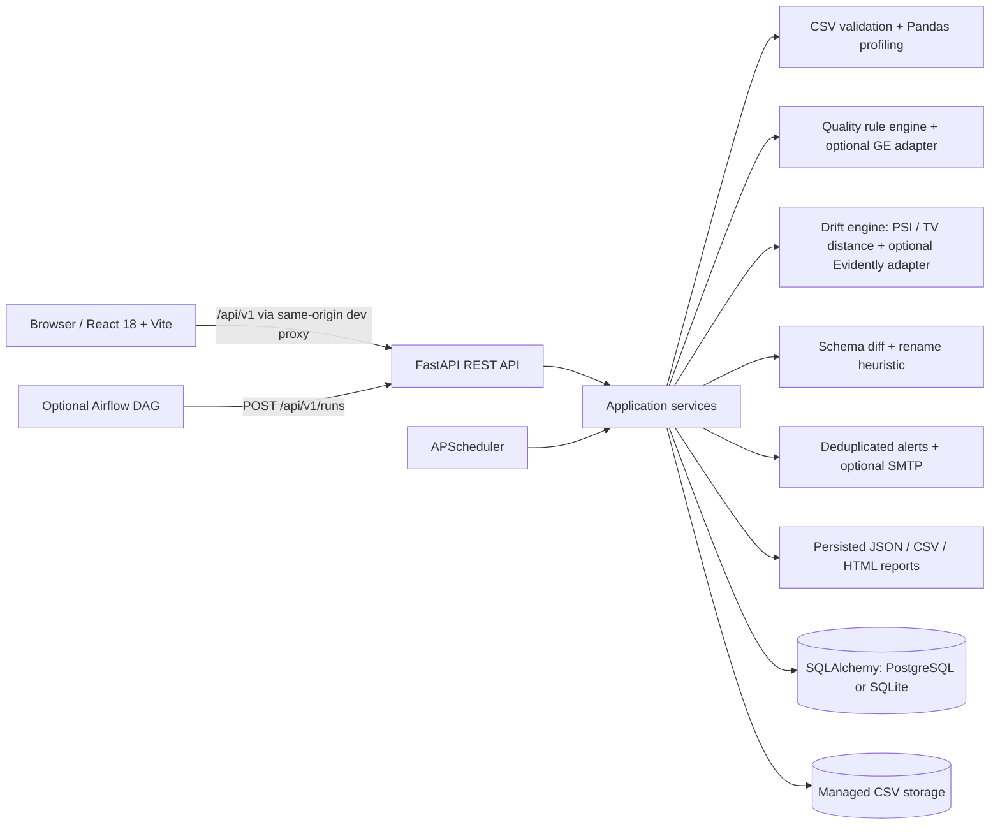

# QualityLens architecture

## Request and monitoring flow

1. A CSV upload is capped by `MAX_UPLOAD_MB`, header-checked, parsed by Pandas, assigned a server UUID filename, and written below `UPLOAD_DIR`. The original name is used only as sanitized display metadata.
2. Reference/current files are independently profiled. Column profiles and dataset-specific default quality rules are committed to the relational database.
3. `POST /api/v1/runs` creates a durable `running` record and executes schema checks, enabled validation rules, feature-level drift, alerts and an automatic JSON report in one processing transaction. A processing error is persisted as a `failed` run with a bounded error message.
4. Overview and page APIs aggregate stored runs/results. Dashboard KPIs are not inserted as demo fixtures.
5. Report downloads are built from persisted run results. HTML output escapes dynamic values; filenames are generated by the server.

## Persistence map

`datasets` → `column_profiles`, `validation_rules`, `monitoring_runs`, `schema_changes`, `alerts`, `schedules`; each run → `validation_results`, one `drift_runs` record → `feature_drift_results`, plus `reports`. `app_settings` stores editable monitoring thresholds. Foreign keys, indexes, delete rules and SQLAlchemy transactions are defined in `app/models.py`; the initial Alembic migration is under `backend/alembic/`.

## Score and drift semantics

The score formula and weights are documented in the API description, quality UI, and each report. Numerical drift uses reference-quantile bins and PSI; categorical drift uses total-variation distance; missingness is compared as an independent absolute-rate delta. The feature statuses are `detected_drift`, `no_drift`, `insufficient_data`, and `failed_comparison`; they are not collapsed into a binary flag. Great Expectations and Evidently adapters are optional and version-tolerant. The deterministic built-in checks/statistics stay the local persisted source of truth even if an adapter is not installed or a library API changes.

## Trust boundary

This is a secure-for-trusted-local-workspace implementation, not an internet-facing multi-tenant service: authentication, authorization, rate limiting, TLS termination, database credential rotation and secret management must be added before public deployment. Database connection errors are reported; an explicitly configured PostgreSQL URL is never silently switched to SQLite.
